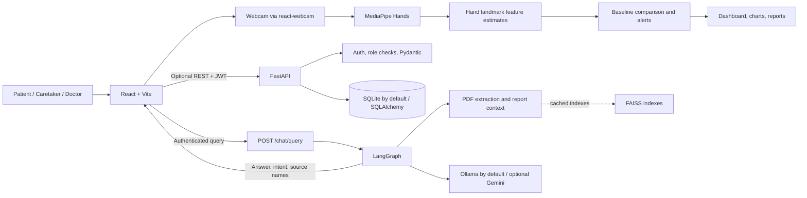

# Kutaksha Development Guide

This guide is a practical, source-aligned specification for understanding,
rebuilding, running, testing, and extending the Kutaksha prototype. It describes
the current implementation, not a clinically validated product. Where a feature
is a demo, heuristic, or future production requirement, that distinction is
called out explicitly.

## 1. Project at a glance

Kutaksha combines:

1. A React single-page application with patient, caretaker, and doctor views.
2. Browser webcam input and MediaPipe Hands landmark tracking.
3. Deterministic client-side comparisons against a wellness baseline.
4. A FastAPI service with JWT authentication and SQLAlchemy models.
5. An optional LangGraph retrieval-augmented assistant over local reports.

The primary demo dashboard persists much of its state in browser local storage.
SQLite is the default backend database. The RAG assistant can use local Ollama
or optional Gemini generation. Running the dashboard does not require the RAG
dependencies, Ollama, or report PDFs.

### Important product boundary

This is an educational and engineering prototype, not a medical device or
clinical decision system. Its risk and stability scores are deterministic
heuristics and have not been clinically validated. MediaPipe Hands tracks hand
landmarks; the resulting labels such as walking speed, gait rhythm, and balance
are proxy metrics, not direct measurements of gait, balance, or disease.
Never use demo scores to diagnose, triage, or prescribe treatment.

## 2. Architecture and data flow



### Main data paths

**Wellness dashboard**

1. The browser requests camera permission.
2. MediaPipe Hands estimates one hand's landmarks in each processed frame.
3. The tracker samples landmark movement and emits approximate metrics.
4. `frontend/src/utils/metrics.js` normalizes values and compares them with a baseline.
5. The dashboards display current values, trends, HSI, risk, severity, and
   alerts. The demo path uses browser storage and does not require every value
   to be written to the backend.

**Medical-record assistant**

1. The signed-in frontend sends a query, prior turns, and optional behaviour
   context to `POST /chat/query`.
2. FastAPI validates the request and authentication.
3. The optional RAG service extracts report text, retrieves evidence, and
   invokes a LangGraph workflow.
4. The graph returns an answer and intent; the service maps source metadata to
   displayable filenames.
5. The frontend displays the answer and its sources. A human must interpret it.

## 3. Repository map

| Path | Responsibility |
|---|---|
| `frontend/src/App.jsx` | Frontend route layout and assistant launcher |
| `frontend/src/main.jsx` | React application entry point |
| `frontend/src/context/AuthContext.jsx` | Frontend authentication/session state |
| `frontend/src/pages/` | Home, assistant, demo, and role-specific dashboard pages |
| `frontend/src/components/CameraTracker.jsx` | Webcam, MediaPipe Hands, and proxy metric extraction |
| `frontend/src/components/LiveCharts.jsx` | Trend visualizations |
| `frontend/src/utils/metrics.js` | Metric normalization, scoring, and deviation alerts |
| `frontend/src/utils/storage.js` | Browser storage used by the demo |
| `frontend/src/utils/reports.js` | Downloadable report/CSV summaries |
| `frontend/src/utils/api.js` | Frontend HTTP client and backend URL |
| `backend/app/main.py` | FastAPI app, middleware, and router registration |
| `backend/app/api/` | Auth, patient, camera, dashboard, demo, and chat endpoints |
| `backend/app/auth.py` and `backend/app/utils/security.py` | JWT and password helpers |
| `backend/app/database.py` | SQLAlchemy engine/session configuration |
| `backend/app/models.py` and `backend/app/schemas.py` | Database models and API validation |
| `backend/app/services/risk_engine.py` | Separate illustrative backend risk evaluator |
| `backend/app/services/explainable_ai.py` | Human-readable demo explanations |
| `backend/app/ai/rag_graph.py` | Optional LangGraph, retrieval, and LLM workflow |
| `backend/app/services/rag_service.py` | Graph invocation and API response/source mapping |
| `backend/tests/` | Backend tests |
| `frontend/src/**/*.test.js` | Frontend utility tests |

## 4. Frameworks, runtimes, and dependencies

Use the manifests as the authoritative dependency lists. The versions below are
the declared ranges in this repository; package managers resolve exact versions
from the lockfile where one exists.

### Frontend

| Area | Stack |
|---|---|
| Runtime | Node.js 18 or newer, npm |
| Framework/build | React 18, Vite 5 |
| UI and charts | Tailwind CSS 3, PostCSS, Autoprefixer, Recharts 3, Lucide React |
| Camera | react-webcam 7.2; MediaPipe Hands and camera helpers load from the jsDelivr CDN, not `package.json` |
| Tests | Vitest 3.2 |

Install and run from the repository root:

```powershell
npm --prefix frontend ci
npm --prefix frontend run dev
```

Useful frontend commands:

```powershell
npm --prefix frontend test
npm --prefix frontend run build
npm --prefix frontend run preview
```

### Backend core

| Area | Stack |
|---|---|
| Runtime | Python 3.11 (provided backend Dockerfile) |
| API | FastAPI 0.110 or newer, Uvicorn standard 0.29 or newer |
| Persistence | SQLAlchemy 2, SQLite by default |
| Validation/security | Pydantic 2, python-jose, Passlib, email-validator |
| Reports/tests | ReportLab, HTTPX, pytest |

Create a virtual environment and install the core backend requirements from
the `backend` directory:

```powershell
cd backend
py -3.11 -m venv .venv
.\.venv\Scripts\python.exe -m pip install --upgrade pip
.\.venv\Scripts\python.exe -m pip install -r requirements.txt
```

### Optional RAG assistant

The optional packages are declared in `backend/requirements-rag.txt`:

- LangGraph and LangChain components for graph orchestration and prompts.
- `langchain-ollama` for local Ollama inference.
- `langchain-google-genai` for optional Gemini inference.
- `langchain-huggingface` and Sentence Transformers for embeddings.
- FAISS CPU for vector search.
- PyMuPDF for extracting text from PDF reports.
- Python dotenv for environment configuration.

Install these only when enabling the assistant:

```powershell
.\.venv\Scripts\python.exe -m pip install -r requirements-rag.txt
```

The `data/requirements.txt` is an additional AI/experiment-oriented
list, not the backend service's core dependency manifest. For the API use the
two manifests under `backend/`.

### Local inference model

The RAG provider defaults to Ollama and `llama3.2:3b`. Install Ollama for the
operating system, ensure its local service is running, and fetch the model:

```powershell
ollama pull llama3.2:3b
```

Model inference is local when using Ollama. The embedding model,
`sentence-transformers/all-MiniLM-L6-v2`, may be downloaded the first time the
RAG index is built.

## 5. Local development setup

### 5.1 Configure the frontend

Copy `frontend/.env.example` to `frontend/.env` and set the API origin:

```env
VITE_API_BASE_URL=http://127.0.0.1:8000
```

Vite only exposes environment variables prefixed with `VITE_` to browser code.
Do not put API keys, database credentials, or signing secrets in a `VITE_`
variable; frontend values are visible to users.

### 5.2 Configure the backend

Copy `backend/.env.example` to `backend/.env`. Configure `JWT_SECRET` to a
private random value for local use, and set RAG options if enabling the
assistant. Never commit `.env` files or real patient records.

Supported settings used by the implementation:

| Variable | Purpose | Default / notes |
|---|---|---|
| `JWT_SECRET` | Signs and verifies backend JWTs | Development fallback exists in code; replace it |
| `DATABASE_URL` | SQLAlchemy connection string | `sqlite:///./kutaksha.db` |
| `LLM_PROVIDER` | RAG generation provider | `ollama`; supported values are `ollama` and `gemini` |
| `OLLAMA_MODEL` | Ollama chat model | `llama3.2:3b` |
| `GEMINI_MODEL` | Gemini chat model | Example file says `gemini-2.5-flash`; code fallback is `gemini-3.6-flash`; select a model available to your API account |
| `GOOGLE_API_KEY` | Gemini credential | Required only when `LLM_PROVIDER=gemini` |
| `RAG_DOCS_DIR` | Report directory | Defaults to `backend/docs` |
| `RAG_INDEX_DIR` | Generated FAISS index directory | Defaults to `backend/rag_index` |

The database module reads `DATABASE_URL` when it is imported. If overriding the
database URL, set it in the process environment before starting Uvicorn. For
example, in the backend PowerShell terminal:

```powershell
$env:DATABASE_URL = "sqlite:///./kutaksha.db"
```

For Gemini, put `LLM_PROVIDER=gemini`, `GEMINI_MODEL=...`, and
`GOOGLE_API_KEY=...` in the backend environment. Do not copy a real API key
into source control or include it in frontend configuration.

### 5.3 Add report documents (optional)

The assistant requires at least one text-readable PDF in `backend/docs/`. CSV
files can be included as additional knowledge data. For safe development, use
synthetic or explicitly authorized, de-identified sample documents. Do not
commit personal health information.

The index is built on the first assistant request and cached under
`backend/rag_index/`. Rebuild it after adding, removing, or changing source
documents; stop the backend and remove only the generated index directory
before restarting.

### 5.4 Start services

Start the API from `backend/`:

```powershell
.\.venv\Scripts\python.exe -m uvicorn app.main:app --reload --host 127.0.0.1 --port 8000
```

Start the frontend from the repository root in another terminal:

```powershell
npm --prefix frontend run dev
```

Check `http://127.0.0.1:8000/health` for backend health. FastAPI's interactive
API documentation is available at `http://127.0.0.1:8000/docs`.

## 6. Design details

### 6.1 Frontend and roles

React pages provide patient, caretaker, and doctor experiences. Authentication
state and role-aware navigation are handled in the frontend context and route
structure. The current demo also uses browser local storage for sample
authentication and wellness history; this is convenient for local demos but is
not a secure or synchronized clinical record store.

Charts are rendered with Recharts. The report utilities export summaries and
CSV data for review. Camera access is browser-mediated and requires the user to
grant permission.

### 6.2 Backend

FastAPI routers are grouped by concern and use Pydantic schemas for request and
response validation. SQLAlchemy provides the persistence layer, with tables
covering users, patients, behaviour history, digital-twin profiles, activity,
risk history, alerts, reports, doctor notes, and notifications.

Protected endpoints use a bearer JWT. Passwords are hashed with Passlib; the
token uses HS256 and has a 30-minute default expiration. Role checks are
available in backend dependencies. For a production system, enforce
authorization and patient-to-user access at every data boundary; frontend
route hiding is not authorization.

The backend's `RiskEngine` is a separate illustrative heuristic from the
frontend scoring in `frontend/src/utils/metrics.js`. Do not assume their values are
interchangeable or equivalent.

### 6.3 Assistant and retrieval pipeline

The optional report-assistant flow is:

1. Validate configuration and confirm that report PDFs exist.
2. Load PDF text using PyMuPDF; load optional CSV files.
3. Split extracted content into chunks of 1,000 characters with 200 characters
   of overlap.
4. Embed chunks with `sentence-transformers/all-MiniLM-L6-v2`.
5. Build and save local FAISS indexes. A general index can include CSV data;
   a medical index is built from report PDFs.
6. On a query, the graph validates the question and gathers report evidence.
   In the current `/chat/query` graph, the retrieval node requests the
   `medical_report` path, which supplies all extracted PDF documents rather than
   performing nearest-neighbour FAISS search. The FAISS stores and retrievers
   are built, but this request path does not currently use them. This preserves
   dated report context in the prototype, but can make prompts large as the
   corpus grows.
7. Attempt deterministic extraction for supported exact questions; otherwise
   use the configured LLM with evidence and bounded prompt instructions.
8. Return answer, intent, and cleaned source filenames through the API.

The graph has a small, explicit sequence of nodes: query validation, retrieval,
and general analysis. The structured-answer path handles selected patient ID,
latest report, case-summary, and walking-speed questions. It is not a general
medical reasoning engine.

The FAISS loader enables deserialization for indexes created by this project.
Only load indexes created locally from trusted documents; never point the app
at an untrusted serialized index.

## 7. Algorithms and metric procedures

All metrics in the browser tracker are approximations based on normalized hand
landmarks. Camera coordinates are not calibrated physical-world coordinates.
The output should not be described as measured walking speed or clinical
balance.

### 7.1 Frame sampling and hand features

`CameraTracker.jsx` configures one hand with model complexity 0 and minimum
detection/tracking confidence 0.5. Frames are processed at most every 40 ms;
metrics are emitted at most every 120 ms. The tracker uses the index fingertip
(landmark 8), middle fingertip (12), and wrist (0).

For two sampled frames separated by `dt` milliseconds:

```text
index_delta  = EuclideanDistance(index_tip_now, index_tip_previous)
middle_delta = EuclideanDistance(middle_tip_now, middle_tip_previous)
average_delta = (index_delta + middle_delta) / 2
velocity_proxy = average_delta / dt * 1000
```

The target speed proxy is `0.35` when velocity is at most `0.03`; otherwise it
is `min(1.35, 0.35 + 2.2 * velocity_proxy)`. An exponential moving average
smooths it:

```text
speed_ema = 0.35 * target_speed + 0.65 * previous_speed_ema
```

This value is called walking speed by the UI, but it is a scaled hand-motion
proxy, not a calibrated gait speed.

The tracker also keeps a rolling buffer of up to 20 movement distances for
jitter estimates and 15 velocity values for rhythm variability. With `s` as the
smoothed speed proxy, `b` as balance, `j` as mean absolute deviation of the
distance buffer, and `r` as standard deviation of the velocity buffer, its
display-oriented formulas are:

```text
activity       = round(clamp((s / 1.3) * 85, 15, 95))
sitting_minutes= round(clamp(130 - (s / 1.3) * 75, 30, 120))
balance        = round(clamp(90 - wrist_delta * 800, 40, 95))
posture        = round(clamp(b + s * 8, 45, 95))
step_stride    = round2(clamp(0.42 + s * 0.21, 0.40, 1.15))
tremor         = round1(clamp(8 + j * 120, 5, 40))
gait_rhythm    = round(clamp(88 - r * 15, 45, 95))
fatigue        = round(clamp(14 + max(0, 1.25 - s) * 28 + tremor * 0.8, 8, 65))
variability    = round1(clamp(max(0, r * 6 + j * 45) / 2.2, 4, 35))
```

`clamp(x, lo, hi)` bounds a value to the inclusive interval; `round1` and
`round2` retain one and two decimal places. Sitting minutes are estimated
inversely from speed; they are not timed sitting observations. Balance and
posture are wrist-motion heuristics. Step stride scales the speed proxy and is
not measured from detected steps. Gait rhythm is derived from variation in
hand-motion velocity, not footfall events.

The tracker also calculates a `heartRateVar`-named demonstration value:

```text
heartRateVar = round(clamp(30 + s * 25 - tremor * 0.5, 25, 65))
```

It does not measure heart rate. `isHighRisk` is a boolean set when
`s < 0.85`, activity is below 50, or balance is below 55; it is not the risk
score shown by the main dashboard formulas.

Several tracking outputs, including `heartRateVar` and `isHighRisk`, are
demonstration fields. A hand-only webcam view cannot infer heart rate or
whole-body gait reliably.

### 7.2 Metric normalization

`normalizeMetrics` accepts finite numeric values and a defined set of
snake_case/camelCase aliases, then falls back to `DEFAULT_BASELINE` for
missing/invalid input. Check the explicit mapping before adding or renaming a
metric; aliases are not automatically generated.
Current default baseline values:

| Metric | Baseline |
|---|---:|
| Walking speed | 1.20 |
| Activity level | 82 |
| Sitting minutes | 48 |
| Balance score | 78 |
| Tremor index | 12 |
| Gait rhythm | 85 |
| Posture stability | 82 |
| Step stride | 0.72 |
| Fatigue index | 18 |
| Movement variability | 11 |

These are demo defaults, not population norms. The current HSI, risk, and
severity formulas compare only selected metrics; sitting duration and gait
rhythm are not included in the HSI formula.

### 7.3 Health Stability Index (HSI)

For each metric, the frontend calculates only an adverse-direction relative
deviation: drops for speed, activity, balance, posture, and stride; rises for
tremor, fatigue, and movement variability. Let each deviation be relative to
the baseline and let the weights be those in the source:

```text
speed_drop       = max(0, (base_speed - current_speed) / base_speed)
activity_drop    = max(0, (base_activity - current_activity) / base_activity)
balance_drop     = max(0, (base_balance - current_balance) / base_balance)
tremor_rise      = max(0, (current_tremor - base_tremor) / max(base_tremor, 1))
posture_drop     = max(0, (base_posture - current_posture) / max(base_posture, 1))
stride_drop      = max(0, (base_stride - current_stride) / max(base_stride, 0.1))
fatigue_rise     = max(0, (current_fatigue - base_fatigue) / max(base_fatigue, 1))
variability_rise = max(0, (current_variability - base_variability) / max(base_variability, 1))

HSI = clamp(round(
  100
  - 24 * speed_drop
  - 18 * activity_drop
  - 14 * balance_drop
  - 12 * tremor_rise
  - 10 * posture_drop
  -  5 * stride_drop
  -  8 * fatigue_rise
  -  6 * variability_rise
), 0, 100)
```

An adverse deviation is floored at zero, so a better-than-baseline result does
not increase HSI above 100. This is a transparent prototype score, not a
validated health index.

### 7.4 Risk score

The frontend risk score adds points for threshold crossings:

| Condition | Points |
|---|---:|
| Speed below 85% of baseline | 20 |
| Activity below 70% of baseline | 15 |
| Speed below 75% of baseline | +10 |
| Balance below 80% of baseline | 15 |
| Tremor above 150% of baseline | 10 |
| Posture below 85% of baseline | 8 |
| Stride below 82% of baseline | 8 |
| Fatigue above 150% of baseline | 8 |
| Variability above 150% of baseline | 6 |

The sum is capped at 100. The speed thresholds are cumulative: crossing 75%
adds both speed penalties. The display label is Low below 40, Medium from 40
through 69, and High from 70 upward.

The backend `RiskEngine` uses a different small set of conditions and starts
from 20 points. It should not be substituted for the frontend formula without
an intentional, tested design change.

The backend evaluator currently adds 18 when activity context is `"walking"`
and tremor index exceeds `0.25`, 8 when sitting duration exceeds `0.5`, and 6
when confidence exceeds `0.9`. It clamps risk to 0-100, sets backend HSI to
`100 - risk`, severity to `min(100, int(risk * 0.8))`, and confidence to
`int(confidence * 100)`. The explanation string is static. These backend
outputs are illustrative and are not the frontend's baseline-relative scores.

### 7.5 Severity score

Severity is a weighted absolute relative deviation. For each included metric:

```text
delta = abs(current - baseline) / max(baseline, 1)  # skip metric if baseline == 0
normalized = min(1, delta * factor)
severity = clamp(round(sum(normalized * weight)), 0, 100)
```

| Metric | Weight | Factor |
|---|---:|---:|
| Walking speed | 18 | 1.35 |
| Activity level | 14 | 1.00 |
| Balance score | 14 | 1.00 |
| Tremor index | 10 | 1.15 |
| Gait rhythm | 8 | 1.00 |
| Posture stability | 8 | 1.00 |
| Step stride | 5 | 1.18 |
| Fatigue index | 3 | 1.00 |
| Movement variability | 2 | 1.00 |

Weights total 82, so the current maximum is bounded by the sum of these
weights before rounding/clamping. Factors and weights are defined in
`frontend/src/utils/metrics.js`; preserve their source values when documenting or
changing the algorithm.

### 7.6 Alerts and persistence

An individual alert is emitted when a metric differs from baseline by at least
20% by default. Alert severity is `caution` at 20-29%, `warning` at 30-39%,
and `critical` at 40% or more. Sustained alerts examine the latest four samples
and require at least three to exceed the configured threshold. The alert code
uses absolute deviation; metric direction is included for display.

### 7.7 Do not confuse similar values

There are at least three different outputs in the repository: frontend HSI and
scores, backend demo scoring, and camera tracker's `isHighRisk` boolean. Keep
their names and purpose distinct. If a single source of truth is required,
define a versioned API contract, migrate consumers, and add shared known-answer
tests before removing any implementation.

## 8. Backend API overview

The API prefixes are registered in `backend/app/main.py`. Check the live
`/docs` page for the current schema and exact payloads.

| Prefix / endpoint | Purpose |
|---|---|
| `/health` | Service health response |
| `/auth/register`, `/auth/login`, `/auth/logout`, `/auth/profile` | User account and bearer-token flow |
| `/patients` | Authenticated patient listing and CRUD |
| `/camera/analyse` | Authenticated camera-analysis request |
| `/dashboard/patient`, `/dashboard/caregiver`, `/dashboard/doctor` | Role-oriented dashboard summaries |
| `/api/detect`, `/api/explain`, `/api/simulate`, `/api/digital-twin` | Demonstration analysis and digital-twin routes |
| `/chat/query` | Authenticated optional RAG assistant |

The chat request schema limits the query to 1-2,000 characters and bounds
behaviour history/trend lists. Responses contain answer text, intent, and
source names. The assistant can return `503` when its optional dependencies,
configuration, or source PDFs are unavailable. Authentication and request
validation failures use standard `401`/`422` responses; see route code and
`/docs` for the precise current contract.

## 9. Development and validation procedure

### 9.1 Suggested implementation sequence

For a clean rebuild or a new contribution, follow this order:

1. **Environment:** install Node.js 18+, Python 3.11, and dependencies from the
   correct manifests.
2. **API baseline:** start the backend, check `/health`, and inspect `/docs`.
3. **Frontend baseline:** start Vite, confirm routes load, and confirm the API
   base URL is correct if connecting the backend.
4. **Authentication:** exercise registration/login and verify bearer-token
   handling before building protected pages.
5. **Dashboard contract:** define metric keys and units, baseline ownership,
   sample timestamps, and storage source before adding charts.
6. **Camera path:** test camera permission and tracker availability; validate
   that losing the hand or camera does not invent a fresh observation.
7. **Scoring:** implement and test the pure functions independently from React.
   Test baseline equality, each threshold boundary, clamping, and sustained
   sample counts.
8. **RAG (optional):** use approved sample reports, build the local indexes,
   test source filenames, and test that the API reports a clear unavailable
   state when setup is incomplete.
9. **Safety review:** check labels, exports, prompts, and API responses to
   ensure demo signals are not presented as diagnoses.

### 9.2 Automated checks

From the repository root:

```powershell
npm --prefix frontend test
npm --prefix frontend run build
```

From `backend/`:

```powershell
.\.venv\Scripts\python.exe -m pytest -q
```

The existing tests cover frontend API/chat utilities and backend health,
authentication requirements, request validation, provider/graph failures, and
RAG service behavior. They do not replace browser testing of webcam
permissions, MediaPipe quality, complete role workflows, report downloads, or
deployed CORS/backend connectivity.

### 9.3 Minimum tests for scoring changes

When modifying scoring or metric extraction, add tests for:

- all metrics exactly matching baseline;
- each one-sided HSI deviation and its expected weight;
- risk immediately below, at, and above every threshold;
- the cumulative 75% and 85% speed threshold behavior;
- zero/invalid baselines and non-finite inputs;
- severity clamping and rounding;
- alert thresholds at 20%, 30%, and 40%;
- sustained deviation with fewer than three bad samples and with three of four;
- input aliases and snake_case/camelCase conversion.

## 10. Deployment model

### Local full-stack

Run Vite, FastAPI, and Ollama separately. Keep PDFs and FAISS indexes on a
controlled local machine. This is the intended route for a complete local
assistant demonstration.

### Frontend hosting

The frontend can be built with `npm --prefix frontend run build` and served by Vercel or another
static host. Set `VITE_API_BASE_URL` to the public backend origin at build
time. A frontend host does not automatically host the FastAPI backend, local
PDF corpus, FAISS index, or local Ollama service.

### Backend hosting

The provided backend Dockerfile uses `python:3.11-slim` and exposes port 8000.
Deploy it only with production secrets, restricted CORS, a production database,
and an explicit RAG/model hosting design. A local Ollama instance is not
available to a cloud backend unless you separately provision a reachable,
secured inference service. Do not expose Ollama or report indexes publicly.

## 11. Privacy, security, and responsible use

Before any real-user or production use, at minimum:

- Replace the development JWT secret and store secrets in a secret manager.
- Restrict CORS to known frontend origins; current application setup allows
  broad origins.
- Enforce authorization by role and patient relationship on every endpoint.
- Replace browser local storage for sensitive records with a secure,
  access-controlled persistence design.
- Encrypt sensitive data in transit and at rest; define retention and deletion.
- Obtain appropriate consent for camera use and report processing.
- Use synthetic or de-identified data in development, tests, screenshots, and
  source control.
- Add audit logging, monitoring, rate limits, incident response, and backup
  procedures.
- Evaluate retrieval quality, source faithfulness, prompt injection resilience,
  and model error behavior.
- Validate any clinical claims with qualified clinicians and applicable
  regulatory experts before use.

Do not upload real reports to a hosted model unless the data handling,
contractual, privacy, and compliance requirements have been reviewed.

## 12. Troubleshooting

| Symptom | Checks |
|---|---|
| Frontend cannot reach the API | Check `VITE_API_BASE_URL`, backend health, port 8000, and browser network errors |
| Camera overlay says access is required | Grant camera permission; verify the page is served from localhost/HTTPS and MediaPipe CDN assets load |
| Tracker does not emit values | Check camera permission, CDN availability, browser console, and whether a hand is visible |
| `/chat/query` returns 503 | Install `backend/requirements-rag.txt`; verify provider, report directory, at least one text-readable PDF, and `GOOGLE_API_KEY` if using Gemini |
| Ollama connection/model error | Start the Ollama service, verify the selected model exists, and run `ollama pull llama3.2:3b` for the default |
| Assistant answers from stale documents | Stop the backend and rebuild the generated `backend/rag_index/` after changing documents |
| Backend cannot import a package | Activate/use the backend virtual environment and install the backend core manifest; install the RAG manifest only for the assistant |
| Database uses an unexpected file | Check the process working directory and the `DATABASE_URL` exported before Python imports the database module |

## 13. Extension checklist

Before introducing a new metric, route, model, or assistant behavior:

1. Define its intended meaning, units, and whether it is measured or inferred.
2. Trace the metric through tracker, normalization, storage, charts, exports,
   API schemas, and RAG context.
3. Name proxy/demo values honestly in the UI and documentation.
4. Add deterministic unit tests and API contract tests for changed behavior.
5. Keep frontend and backend scoring differences explicit or migrate them
   deliberately with compatibility tests.
6. Preserve evidence/source attribution for report answers.
7. Review privacy, authorization, error handling, and human oversight.
8. Run frontend tests/build and backend tests before merging.

## 14. Source references

- `README.md` - project overview, development notes, and assistant setup.
- `PROJECT_REPORT.md` - project scope, methodology, limitations, and results.
- `frontend/src/components/CameraTracker.jsx` - tracking implementation.
- `frontend/src/utils/metrics.js` - frontend scoring and alert formulas.
- `backend/app/services/risk_engine.py` - backend demonstration scorer.
- `backend/app/ai/rag_graph.py` - optional assistant graph and retrieval.
- `backend/app/services/rag_service.py` - assistant service response mapping.
- `backend/app/api/` - API route implementations.
- `backend/tests/` and `frontend/src/**/*.test.js` - automated tests.
