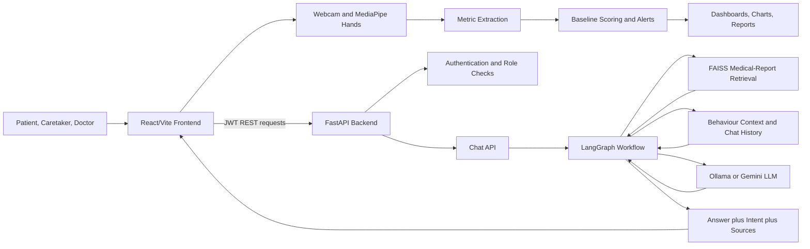
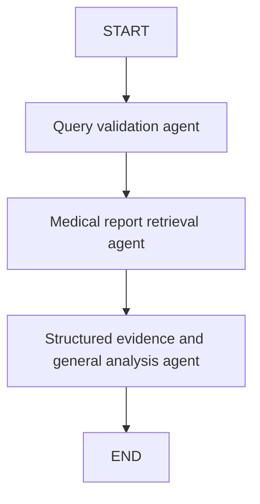

# Kutaksha
## An Agentic AI-Enabled Preventive Elder-Wellness Monitoring Platform

**Project report**

**Project type:** Full-stack healthcare technology prototype  
**Frontend:** React, Vite, Tailwind CSS, Recharts, react-webcam  
**Backend:** FastAPI, SQLAlchemy, SQLite, JWT authentication  
**AI components:** MediaPipe Hands, deterministic behavioural scoring, LangGraph, FAISS, Ollama/Gemini-compatible RAG  
**Deployment modes:** Local full-stack deployment and Vercel frontend deployment with a separately hosted backend

---

## Abstract

This report presents Kutaksha, a preventive elder-wellness monitoring prototype. The idea is to make gradual changes in movement easier to notice and discuss. The application brings together browser-based computer vision, patient-specific baseline comparison, explainable risk scoring, role-based dashboards, and an agentic medical-record assistant.

For the demonstration, the browser captures hand movement through a webcam and MediaPipe Hands. The landmark motion is converted into observational values such as walking speed, activity level, balance, tremor, gait rhythm, posture stability, fatigue, and movement variability. The values are compared with a baseline to calculate a Health Stability Index, risk score, severity score, and deviation alerts. A separate assistant uses a LangGraph workflow to validate a question, retrieve relevant medical-report content from FAISS indexes, add recent dashboard behaviour and conversation history, and choose between a structured answer and an LLM-generated answer. Source filenames are returned when they are available.

It is important to state the boundary of the work clearly. Kutaksha is a decision-support demonstration, not a clinical diagnostic device. The scoring rules have not been clinically validated, and the main browser dashboard uses demo data stored in local storage. The value of the prototype is in showing a complete workflow and its design trade-offs, rather than claiming medical accuracy.

**Keywords:** eldercare, preventive healthcare, agentic AI, RAG, LangGraph, FAISS, computer vision, explainable AI, digital twin, FastAPI, React

---

## 1. Introduction

Ageing populations require continuous observation of mobility, activity, and behavioural changes. In many care settings, information is collected intermittently and is distributed across patient observations, reports, and caregiver notes. Small changes can therefore be difficult to compare over time.

Kutaksha addresses this problem through a browser-based platform that puts movement-derived indicators in one shared interface. It also includes a medical-record assistant, so a care-team member can ask about uploaded reports without searching through every document manually.

The implementation is organised around three practical parts:

1. **Observation:** capture movement signals and represent them as metrics.
2. **Interpretation:** compare current values with a patient baseline and produce explainable indicators.
3. **Assistance:** retrieve medical evidence and help a signed-in care-team member ask questions about reports and trends.

The application is intended to support review and communication. It does not replace a doctor, issue diagnoses, or prescribe treatment.

## 2. Problem Statement

Care teams need a practical way to:

- observe mobility-related changes over time;
- compare current behaviour with a patient-specific baseline;
- communicate risk signals to different user roles;
- connect behavioural observations with medical-record evidence;
- preserve source traceability when an AI assistant answers a question; and
- maintain human oversight for decisions involving health and safety.

Many dashboards show measurements without the surrounding record, while a general chatbot may answer without reliable evidence. This prototype connects the trend view with a retrieval-grounded assistant, while keeping the final decision with the user and care team.

## 3. Aim and Objectives

### 3.1 Aim

To develop a full-stack preventive elder-wellness prototype that converts browser movement observations into explainable trends and provides a source-grounded, agentic assistant for medical-record questions.

### 3.2 Objectives

- Build role-specific experiences for patients, caretakers, and doctors.
- Capture webcam movement signals without requiring a dedicated wearable device.
- Extract a consistent set of wellness-related observational metrics.
- Compare metrics with a patient baseline using transparent rules.
- Display HSI, risk, severity, alerts, and trends in a readable dashboard.
- Provide downloadable report text and CSV summaries.
- Secure backend routes with JWT authentication.
- Implement a LangGraph RAG workflow for report-grounded questions.
- Return source filenames with assistant responses where available.
- Support local development with Ollama and optional hosted Gemini inference.

## 4. Scope

### 4.1 Implemented scope

- React/Vite single-page frontend.
- Patient, caretaker, and doctor dashboard routes.
- Webcam input with MediaPipe Hands landmark tracking.
- Baseline comparison and deterministic scoring utilities.
- Trend charts and browser-persisted demo metrics.
- FastAPI authentication and API routes.
- Medical-report PDF ingestion and FAISS retrieval.
- LangGraph assistant with structured and LLM-assisted answer paths.
- Local Ollama execution using `llama3.2:3b`.
- Optional Gemini provider configuration.
- Frontend and backend automated tests.

### 4.2 Out of scope

- Clinical diagnosis or treatment recommendation.
- Clinical validation, regulatory certification, or medical efficacy claims.
- A trained disease-prediction model.
- Production-grade multi-tenant data synchronization.
- Automatic emergency response or autonomous clinical action.
- Guaranteed identity verification from a webcam.
- Cloud hosting of Ollama on Vercel.

## 5. System Architecture



### 5.1 Frontend layer

The frontend is implemented with React and Vite. It provides navigation, authentication state, dashboards, camera tracking, charts, assistant interaction, and report exports. The primary demo state is persisted in browser local storage so the prototype can run without a production database.

### 5.2 Backend layer

FastAPI exposes authentication, patient, camera-analysis, dashboard, demo, health, and chat routes. SQLAlchemy provides the persistence abstraction, with SQLite as the default local database. JWT tokens protect signed-in routes.

### 5.3 AI and analytics layer

The analytics path combines MediaPipe landmark observations with deterministic baseline formulas. The assistant path uses a LangGraph workflow, FAISS retrieval, optional LLM generation, structured answer rules, source cleanup, and error handling.

## 6. User Roles and Workflows

### 6.1 Patient

The patient can view personal wellness indicators, start camera tracking, inspect trends, and review alerts. The patient experience is designed to make the current state understandable without exposing unnecessary clinical complexity.

### 6.2 Caretaker

The caretaker can monitor a patient, review HSI and risk trends, inspect alerts, and generate summaries for communication with the care team.

### 6.3 Doctor

The doctor can access a broader overview, compare patient trends, inspect detailed metrics, and use reports and the assistant as supporting evidence during review.

### 6.4 Assistant workflow

1. A signed-in user opens the Assistant page or floating assistant launcher.
2. The frontend sends the query, recent chat history, and current behaviour context.
3. FastAPI validates authentication and the request schema.
4. The RAG service retrieves relevant medical-report evidence.
5. The graph selects a structured answer for supported factual/trend questions or invokes the configured LLM.
6. The response returns answer text, intent, and cleaned source filenames.
7. The user remains responsible for interpreting the result with an appropriate professional.

## 7. Agentic AI Design

### 7.1 What agentic AI means in this project

In this project, “agentic AI” does not mean that the model is allowed to act independently in the clinical system. It refers to the coordinated workflow around the model. One stage validates the question, another gathers evidence, another checks whether a direct structured answer is possible, and the final stage generates or maps the response. LangGraph keeps these steps in a defined order and passes a shared state between them.

### 7.2 Agents and workflow stages

| Stage | Responsibility | Output |
|---|---|---|
| Query agent | Validates and normalizes the user question | `user_query`, initial intent, message state |
| Retrieval agent | Searches the medical-report index and attaches source context | `retrieved_context`, retrieved documents |
| Evidence/record analyzer | Recognizes record questions and exact structured patterns | Patient/report/trend answer when deterministic rules apply |
| General analysis agent | Uses bounded prompt instructions, records, behaviour context, and chat history | LLM-supported answer |
| Source and response mapper | Cleans source names and maps the result to the API schema | `answer`, `intent`, `sources` |

The implemented LangGraph edges are:



### 7.3 Deterministic answer path

The assistant does not call the LLM for every question. For a few predictable requests, the code extracts the answer directly from the retrieved text. This currently covers questions such as:

- latest report;
- patient identifier;
- key findings;
- medication information;
- walking-speed trends; and
- complete case summaries.

This was a deliberate implementation choice. It avoids changing exact dates and measurements during paraphrasing, makes the common factual cases faster, and gives the test suite a stable behaviour to check.

### 7.4 Retrieval-augmented generation

Medical PDFs are loaded, split into chunks, embedded with a Hugging Face sentence-transformer model, and stored in FAISS indexes. A question retrieves report passages before the answer stage. Source metadata is preserved and returned as filenames, allowing the user to see which record contributed to the response.

### 7.5 Guardrails

The assistant prompt and graph enforce the following controls:

- use retrieved records as evidence;
- keep medical-report values separate from live dashboard values;
- do not invent patient facts;
- do not diagnose or prescribe new treatment;
- keep focused questions focused;
- acknowledge missing evidence; and
- label behaviour metrics as observational signals.

## 8. Computer-Vision and Analytics Methodology

### 8.1 Landmark processing

MediaPipe Hands provides frame-level hand landmarks. Kutaksha observes index-finger, middle-finger, and wrist positions. Position changes over time are converted into movement velocity and smoothed with an exponential moving average.

### 8.2 Derived metrics

The tracker derives:

- walking speed estimate;
- activity level;
- sitting duration estimate;
- balance score;
- tremor index;
- gait rhythm;
- posture stability;
- step stride;
- fatigue index; and
- movement variability.

These are proxy signals generated for demonstration and should not be interpreted as direct clinical measurements.

### 8.3 Health Stability Index

The HSI starts from a stability score of 100 and subtracts weighted deviations from baseline. Deviation terms include speed, activity, balance, tremor, posture, stride, fatigue, and movement variability.

In simplified form:

$$
HSI = clamp\left(100 - \sum_i w_i d_i,\ 0,\ 100\right)
$$

where $d_i$ is a normalized deviation and $w_i$ is the metric weight.

### 8.4 Risk score

The risk score uses threshold rules. Points are added when key measurements cross relative baseline thresholds, for example reduced walking speed, reduced activity, reduced balance, increased tremor, reduced posture stability, increased fatigue, or increased movement variability.

### 8.5 Severity score and alerts

Severity is a weighted normalized distance from baseline. Individual alerts are produced when deviation reaches a configured threshold. Sustained alerts require repeated deviation across recent samples, which reduces the importance of a single noisy observation.

## 9. Backend API Design

| Route group | Purpose |
|---|---|
| `/auth` | Registration, login, logout, and profile retrieval |
| `/patients` | Patient-facing data access |
| `/camera` | Camera-analysis service integration |
| `/dashboard` | Role-oriented dashboard summaries |
| `/api` | Demonstration analysis, explanation, simulation, and digital-twin routes |
| `/chat/query` | Authenticated RAG assistant requests |
| `/health` | Service health verification |

The chat request includes a query, optional prior turns, and optional behaviour context. The response includes answer text, intent, and source filenames. Errors are mapped to meaningful HTTP statuses such as `401`, `422`, `502`, `503`, and `429`.

## 10. Security, Privacy, and Responsible AI

### 10.1 Implemented controls

- JWT authentication for protected backend routes.
- Password hashing through the backend authentication layer.
- Role-aware frontend dashboard routing.
- Request validation with Pydantic schemas.
- RAG errors returned as controlled API responses.
- Source names returned instead of exposing full retrieval blobs to the UI.
- Local camera processing in the browser for the demo tracking path.

### 10.2 Privacy principles

The prototype should follow data minimization: collect only what is required for the requested workflow, avoid committing real reports or secrets, and make the user aware of whether a value is a report observation, a live proxy signal, or an AI-generated explanation.

### 10.3 Responsible AI position

Kutaksha is an assistive system. It must not be marketed as a diagnosis engine or as a substitute for a clinician. A production version would require clinical validation, bias evaluation across populations, consent management, audit logs, encryption, retention controls, human escalation, and regulatory review.

## 11. Implementation Structure

Important modules include:

- `frontend/src/App.jsx` - frontend routing and assistant launcher.
- `frontend/src/components/CameraTracker.jsx` - webcam and landmark tracking.
- `frontend/src/utils/metrics.js` - baseline normalization and scoring formulas.
- `frontend/src/utils/storage.js` - demo persistence and session state.
- `frontend/src/pages/*Dashboard.jsx` - role-specific experiences.
- `frontend/src/pages/AssistantPage.jsx` - assistant UI and behaviour-context assembly.
- `backend/app/main.py` - FastAPI application and route registration.
- `backend/app/api/chat_routes.py` - authenticated chat endpoint.
- `backend/app/ai/rag_graph.py` - LangGraph orchestration and retrieval.
- `backend/app/services/rag_service.py` - service abstraction and response cleanup.
- `backend/app/services/explainable_ai.py` - explanation generation.
- `backend/app/services/risk_engine.py` - backend demonstration risk logic.
- `backend/docs/` - local medical-report source documents.

## 12. Testing and Verification

### 12.1 Automated tests

Frontend tests cover API error descriptions and chat-history construction. Backend tests cover health checks, authentication requirements, request validation, provider failures, graph failures, chat-history forwarding, and RAG service behaviour with test doubles.

### 12.2 Local verification performed

The following integration conditions have been verified during development:

- backend health endpoint returns a healthy service response;
- frontend production build completes successfully;
- RAG dependencies are installed in the project virtual environment;
- Ollama is installed and `llama3.2:3b` is available;
- an authenticated real chat request returns a report-grounded answer; and
- a source filename is returned with the assistant response.

### 12.3 Test limitations

Automated browser coverage for webcam permissions, MediaPipe landmark quality, full dashboard interaction, report downloads, and deployed frontend-to-backend operation should be added before production use.

## 13. Results and Discussion

The local test run followed this path from observation to explanation:

1. The browser obtains movement landmarks.
2. The tracker produces normalized proxy metrics.
3. Baseline comparison produces HSI, risk, severity, and alerts.
4. Dashboards present trends for different roles.
5. Medical reports are indexed for retrieval.
6. The agentic assistant combines retrieved evidence, behaviour context, and conversation history.
7. Structured responses preserve exact values for selected questions.
8. General supported questions can be answered using the configured local LLM.

During local verification, the assistant returned a grounded summary of the latest Rajesh Kumar report and cited `Rajesh_Kumar_2026-09-10.pdf`. This was a useful integration check because it exercised the installed RAG packages, FAISS index, report documents, Ollama model, authentication, FastAPI route, and frontend response format in one request.

## 14. Deployment Model

### 14.1 Local full-stack deployment

The complete assistant is best demonstrated locally:

- Vite or Vite preview serves the frontend.
- FastAPI serves the backend on port `8000`.
- Ollama serves the local language model.
- Medical PDFs and FAISS indexes remain on the local machine.

### 14.2 Vercel deployment

The repository's Vercel configuration builds and serves the frontend SPA. Vercel does not automatically provide the Python backend, local medical files, or Ollama runtime. For a deployed chatbot, the frontend must set `VITE_API_BASE_URL` to a publicly reachable backend URL, and that backend must separately provide its model, documents, indexes, secrets, and database.

Therefore, Vercel is suitable for the frontend deployment, while the complete RAG system requires a separate backend hosting strategy or a hosted model and retrieval service.

## 15. Reproducibility Instructions

### 15.1 Frontend

```powershell
npm --prefix frontend install
npm --prefix frontend run build
npm --prefix frontend run dev
```

### 15.2 Backend

```powershell
cd backend
..\.venv-1\Scripts\python.exe -m pip install -r requirements.txt
..\.venv-1\Scripts\python.exe -m pip install -r requirements-rag.txt
..\.venv-1\Scripts\python.exe -m uvicorn app.main:app --reload --host 127.0.0.1 --port 8000
```

### 15.3 Local model

```powershell
ollama pull llama3.2:3b
```

Set the backend environment to:

```env
LLM_PROVIDER=ollama
OLLAMA_MODEL=llama3.2:3b
```

Set the frontend environment to:

```env
VITE_API_BASE_URL=http://127.0.0.1:8000
```

### 15.4 Tests

```powershell
npm --prefix frontend test
cd backend
..\.venv-1\Scripts\python.exe -m pytest -q
```

## 16. Limitations

- The scoring system is deterministic prototype logic, not a clinically trained model.
- MediaPipe Hands tracks hand landmarks; it is not a complete full-body gait-analysis system.
- Browser local storage is not appropriate for production clinical records.
- Some backend routes and demo values are illustrative.
- Local Ollama is not directly deployable as a standard Vercel function.
- CORS, development secrets, SQLite, and demo credentials require hardening before production.
- The available report corpus is small and patient-specific.
- Model output may still be incorrect; retrieved sources and human review remain necessary.

## 17. Future Work

1. Replace proxy metrics with clinically validated multimodal sensing and evaluation.
2. Add consent, encryption, tenant isolation, audit logs, and retention policies.
3. Move persistent data from browser storage and SQLite to a secure production datastore.
4. Add real-time caregiver notifications with escalation and acknowledgement workflows.
5. Add evaluation datasets for retrieval precision, answer faithfulness, and fairness.
6. Add automated end-to-end browser tests and accessibility testing.
7. Support a managed vector database and hosted model for cloud deployment.
8. Add clinician review and correction feedback to the assistant workflow.
9. Introduce model monitoring, prompt/version tracking, and rollback controls.
10. Validate all health-related claims through clinical and regulatory processes.

## 18. Conclusion

Kutaksha brings several parts of the same care workflow into one working prototype: browser observation, transparent baseline analytics, role-based views, explainable indicators, and a report-grounded assistant. The agentic part is useful here because it gives the assistant a controlled sequence for gathering evidence and answering a question, rather than treating the LLM as an unrestricted source of medical facts.

The work should be judged as a responsible prototype. It shows how AI can help organise evidence and surface trends while leaving interpretation with the user and clinician. The most important next steps are clinical validation, privacy, evaluation, deployment reliability, human oversight, and data governance, rather than simply adding a larger model.

## References and Project Evidence

- `README.md` - project scope, architecture, metrics, and RAG setup.
- `frontend/src/components/CameraTracker.jsx` - browser landmark tracking and metric extraction.
- `frontend/src/utils/metrics.js` - baseline comparison, HSI, risk, severity, and alerts.
- `backend/app/ai/rag_graph.py` - LangGraph workflow, retrieval, structured answers, and guardrails.
- `backend/app/services/rag_service.py` - RAG service abstraction and source cleanup.
- `backend/app/api/chat_routes.py` - authenticated assistant API.
- `backend/tests/` - backend verification suite.
- `frontend/src/utils/*.test.js` - frontend utility tests.
